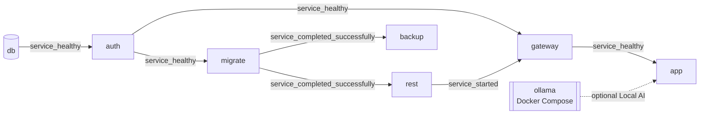

# Docker Deployment Plan — Offline Edition

| Field | Value |
|---|---|
| Status | **Proposed** — Phase 1 planning only. Nothing in this document is implemented yet. |
| Date | 2026-10-19 |
| Decision record | [`OFFLINE-ARCHITECTURE-ADR.md`](OFFLINE-ARCHITECTURE-ADR.md) |
| Target host | Client notebook — Windows 11, Ryzen 7 6800H, 16 GB RAM, AMD Radeon iGPU |

> Guardrails: no Supabase Cloud or Vercel changes, no `.env.local` edits, no `v1.2.1` tag changes, no linked DB resets, no printed or copied secrets. All Windows-side checks in this plan are read-only unless an operator explicitly runs an approved setup step.

---

## 1. Scope

In scope: container topology, networks, ports, volumes, startup order and health checks, image build and offline distribution, configuration and secrets, prerequisite audit, resource budget, local fonts, clock-drift handling, OWNER password reset, backup/retention/off-device copy/restore, Windows operator workflow, upgrades, logging and hardening.

Not in scope: data migration (see [`DATA-MIGRATION-PLAN.md`](DATA-MIGRATION-PLAN.md)), acceptance tests (see [`OFFLINE-ACCEPTANCE-CRITERIA.md`](OFFLINE-ACCEPTANCE-CRITERIA.md)), schedule (see [`IMPLEMENTATION-ROADMAP.md`](IMPLEMENTATION-ROADMAP.md)).

## 2. Client notebook prerequisite audit (read-only design, D3)

Script (Phase 2): `scripts/windows/Test-TomYum-OfflinePrerequisites.ps1` with a `.cmd` wrapper. Runs as a standard user; when elevated it can read more, but it never changes anything.

**Hard rule:** the script does not install, enable, start, stop, restart or configure anything — no BIOS, WSL, Docker, Windows optional features, services, firewall, hosts file or networking changes, and it does not start Docker Desktop, WSL distros or Ollama.

| # | Check | Source (read-only) | PASS | WARN | FAIL |
|---|---|---|---|---|---|
| P01 | Windows edition, version, build | `Get-CimInstance Win32_OperatingSystem` | Windows 11 meeting Docker Desktop's published minimum | Older supported build | Unsupported build |
| P02 | CPU architecture | `$env:PROCESSOR_ARCHITECTURE`, `Win32_Processor` | AMD64 | — | ARM64/x86 |
| P03 | Physical RAM | `Win32_ComputerSystem.TotalPhysicalMemory` | ≥ 16 GB | 8–16 GB | < 8 GB |
| P04 | Free disk on system drive and Docker data drive | `Get-PSDrive` / `Win32_LogicalDisk` | ≥ 50 GB | 30–50 GB | < 30 GB |
| P05 | BIOS virtualization | `Win32_Processor.VirtualizationFirmwareEnabled`, `Win32_ComputerSystem.HypervisorPresent` | Firmware enabled, or hypervisor already present | Indeterminate | Disabled and no hypervisor |
| P06 | WSL | `wsl.exe --status`, `wsl.exe --version`, `wsl.exe -l -v` (UTF-16 output decoded) | WSL2 default, Store WSL present | WSL1 default | WSL absent |
| P07 | Windows optional features (VirtualMachinePlatform, Microsoft-Windows-Subsystem-Linux) | `Get-WindowsOptionalFeature -Online` (needs elevation) | Enabled | **NOT CHECKED** when not elevated | Disabled |
| P08 | Docker Desktop installed | Uninstall registry key `DisplayVersion`, `Docker Desktop.exe` path | Installed, version recorded | — | Absent |
| P09 | Docker Engine reachable | `docker version --format json` | Client + Server (linux) reported | Client only (Desktop not running) | CLI absent |
| P10 | Docker Compose | `docker compose version` | v2 present | — | Absent |
| P11 | Docker resources | `docker info --format json` (`MemTotal`, `NCPU`), `%USERPROFILE%\.wslconfig` (read) | Validated profile: 8 GB VM memory, 8 processors | > 8 GB or no cap: review Windows headroom | < 7 GB: insufficient validated headroom for `qwen3.5:4b` |
| P12 | Port usage | `Get-NetTCPConnection -State Listen` + owning process | 3000/3100/5432/8000/9999/54321–54324 free | Used by a known TYBC process (e.g., old launcher) | Used by an unknown process |
| P13 | Ollama image available | `docker image inspect ollama/ollama:0.40.4` | Present | — | Missing |
| P14 | Ollama persistent volume | `docker volume inspect ${TYBC_OLLAMA_VOLUME}` | Present | — | Missing |
| P15 | Model availability (runtime gate) | `docker compose exec -T ollama ollama list` contains `qwen3.5:4b` | Present | Service not running | Missing |
| P16 | Ollama exposure | Compose/inspect shows no host binding for port `11434` | Docker-internal only | — | Any Windows/LAN host binding |
| P17 | Time | Time zone (`Get-TimeZone`), `w32tm /query /status` (if permitted) | `SE Asia Standard Time` | Not synced recently | Other time zone |
| P18 | Power | `powercfg /a`, active scheme (read) | — | Sleep on AC < 60 min (informational) | — |

Output:

- Console table with PASS/WARN/FAIL/NOT CHECKED and a remediation hint per row (text only — the operator performs fixes manually, after approval).
- JSON report (`-OutFile`, default `C:\TomYumBangC\reports\prereq-<yyyyMMdd-HHmmss>.json`; the folder is created only if the operator passes `-OutFile` or confirms).
- Exit code: `0` all PASS, `1` any WARN/NOT CHECKED, `2` any FAIL.
- No secrets, usernames or file contents beyond the listed facts.

## 3. Container topology

| Service | Image | Command / role | Networks | Published | Restart | Health check |
|---|---|---|---|---|---|---|
| `db` | `supabase/postgres:17.11.0.003@sha256:…` | Postgres 17 with Supabase roles | `tybc_backend` | none | `unless-stopped` | `pg_isready -U postgres -h 127.0.0.1` every 5 s, 60 retries |
| `auth` | `supabase/gotrue:v2.197.0@sha256:…` | GoTrue; runs its own `auth` schema migrations at start | `tybc_backend` | none | `unless-stopped` | `wget -q --spider http://127.0.0.1:9999/health` |
| `migrate` | `tybc-ops:<release>` (FROM pinned `supabase/postgres`) | One-shot: apply `supabase/migrations` and record versions | `tybc_backend` | none | `no` | exit code 0 |
| `rest` | `postgrest/postgrest:v14.18@sha256:…` | PostgREST API on 3000, admin on 3001 | `tybc_backend` | none | `unless-stopped` | probed by `gateway` (image has no shell) |
| `gateway` | nginx unprivileged alpine `@sha256:…` | Routes `/auth/v1/*` and `/rest/v1/*`, `apikey` allowlist | `tybc_backend` | none | `unless-stopped` | `wget` to `/healthz`, `http://auth:9999/health`, `http://rest:3001/ready` |
| `app` | `tybc-app:<release>` | Next.js standalone `node server.js` | `tybc_backend`, `tybc_edge` | `127.0.0.1:3000` | `unless-stopped` | `GET http://127.0.0.1:3000/login` → 200 |
| `ollama` | `ollama/ollama:0.40.4` | Local AI inference with `qwen3.5:4b` | `tybc_backend` | none | `unless-stopped` | `ollama list` |
| `backup` | `tybc-ops:<release>` | Scheduler loop: daily logical backup, retention, manifest | `tybc_backend` | none | `unless-stopped` | heartbeat file younger than 30 min |

All long-running services: `security_opt: no-new-privileges:true`, log driver `json-file` with `max-size: 10m`, `max-file: 3`. No container mounts the Docker socket.

## 4. Networks

| Network | Driver | `internal` | Members | Purpose |
|---|---|---|---|---|
| `tybc_backend` | bridge | **true** (no route out of the host) | db, auth, migrate, rest, gateway, backup, app, ollama | All data-plane and Local AI traffic |
| `tybc_edge` | bridge | false | app | Publishing the application on Windows loopback only |

`app` requires no host bridge or `extra_hosts` entry for Local AI. It reaches Ollama through Docker DNS at `http://ollama:11434`. The app remains on `tybc_edge` only for its loopback host publication. When the notebook is temporarily online, the app makes no outbound calls by design (OpenAI disabled, fonts local, telemetry off) — verified by AC-NET-*.

## 5. Port map

| Endpoint | Container port | Host binding | Reachable from |
|---|---|---|---|
| App (production-offline) | `app:3000` | **`127.0.0.1:3000`** | Notebook browser only |
| App (rehearsal project) | `app:3000` | `127.0.0.1:3100` | Developer only, during rehearsals |
| Gateway | `gateway:8000` | — | `app`, ops one-offs |
| GoTrue | `auth:9999` | — | `gateway`, ops one-offs |
| PostgREST API / admin | `rest:3000` / `rest:3001` | — | `gateway` |
| PostgreSQL | `db:5432` | — | backend services; ops via `docker compose exec` |
| Ollama | `ollama:11434` | — | `app` through the internal `tybc_backend` network only |

Rules: no `0.0.0.0` bindings; no DB, gateway or GoTrue port is ever published (ops access uses `docker compose exec`/`run` inside the backend network). The prerequisite check and AC-SEC-01 verify listeners.

Coexistence before cutover: the existing cloud launcher uses `127.0.0.1:3000`. The offline stack uses `127.0.0.1:3100` (rehearsal project) until cutover, and `Start-TomYum-Offline` refuses to start if the cloud launcher's PID file in `.runtime\` is live. Session cookies do not collide: `supabase-js` names them after the URL host (`sb-gateway-auth-token` locally vs `sb-<cloud-ref>-auth-token`).

## 6. Volume and filesystem map

| Name | Type | Mounted at | Contents | Protection |
|---|---|---|---|---|
| `tybc_db_data` | Docker named volume, **`external: true`**, ext4 inside Docker Desktop's VM disk | `db:/var/lib/postgresql/data` | Live database cluster | Not removed by `compose down -v` (external); daily logical backups |
| `tybc_db_data_<yyyyMMdd-HHmm>` | named volume (blue/green) | same, selected via `TYBC_DB_VOLUME` | Restored/migrated candidate | Old volume retained 14 days after a switch |
| `tybc_ollama_data` | Docker named volume, **`external: true`** | `ollama:/root/.ollama` | Ollama model store including `qwen3.5:4b` | Persistent across normal Compose shutdown; never remove during normal operation |
| `C:\TomYumBangC\backups` | bind mount (NTFS) | `backup:/backups` (rw), `migrate`/ops: ro when restoring | Backup sets | Weekly USB copy, SHA-256 |
| `C:\TomYumBangC\release\<ver>\db-init\90-tybc-roles.sh` | bind mount, read-only file | `db:/docker-entrypoint-initdb.d/init-scripts/90-tybc-roles.sh` | Role passwords, `tybc_backup` role (first init only) | In release bundle, checksummed |
| `C:\TomYumBangC\release\<ver>\gateway\nginx.conf.template` | bind mount, read-only | `gateway:/etc/nginx/templates/` | Routes + key map (rendered with envsubst at start) | Release bundle |
| `C:\TomYumBangC\state` | bind mount | `backup:/state` | Heartbeat, last backup status, last-seen UTC | Small, non-secret |
| app `/tmp`, `.next/cache` | `tmpfs` | `app` | Runtime cache | Ephemeral |

Windows folder layout (created by the Phase 5 setup step, after approval):

```text
C:\TomYumBangC\
  release\<version>\     compose.yaml, compose.rehearsal.yaml, db-init\, gateway\, scripts\, images\*.tar, RELEASE.json, SHA256SUMS
  config\offline.env     non-secret settings (from offline.env.example)
  secrets\offline.secrets.env   secrets (restricted ACL)
  backups\daily|weekly|monthly|manual|pre-upgrade|pre-restore|cutover\
  state\                 heartbeat, last-backup.json, last-seen-utc.txt, active-volume.txt, usb-log.csv
  logs\                  launcher/ops logs (30-day retention)
  reports\               prerequisite and reconciliation reports
  acceptance\<date>\     acceptance evidence
```

Docker Desktop keeps named volumes in its VM disk (`%LOCALAPPDATA%\Docker\wsl\disk\docker_data.vhdx` by default). "Clean / Purge data", "Reset to factory defaults" or uninstalling Docker Desktop **deletes** them — this is called out in the operator runbook and is the reason backups live outside the VM.

## 7. Startup dependency graph



Order rationale:

1. `db` first boot runs the image's init plus `90-tybc-roles.sh` (role passwords, `tybc_backup`).
2. `auth` creates/upgrades the `auth` schema (GoTrue migrations). Repo migrations reference `auth.users`, so they must run after it.
3. `migrate` applies only unapplied repo migrations, then exits 0. A failure stops the chain — `rest`, `gateway` and `app` never start against a half-migrated database.
4. `rest` starts after migrations, so its schema cache already contains every table/function.
5. `app` starts only after the gateway reports both upstreams ready.
6. Ollama runs as a Compose service but is **not** an `app.depends_on` dependency. If it is stopped or unhealthy, the Local AI feature degrades while the application and core stock functions remain available. This was validated by stopping Ollama, force-recreating `app`, and confirming `app` returned healthy.

Targets: warm start (Docker engine ready → `app` healthy) ≤ 120 s; first-ever initialisation ≤ 5 min. `Start-TomYum-Offline` waits up to 180 s, then prints which service is unhealthy.

## 8. Images, build and offline distribution

**App image (`tybc-app`)** — multi-stage Dockerfile (Phase 3):

1. `deps`: Node LTS (pinned by digest) + `npm ci` from `package-lock.json`.
2. `build`: `TYBC_BUILD_TARGET=docker NEXT_TELEMETRY_DISABLED=1 next build` → `output: "standalone"` (conditional in `next.config.ts`). **No `NEXT_PUBLIC_*` values and no secrets** are present at build time.
3. `runtime`: minimal Node image, non-root `node` user, copies `.next/standalone`, `.next/static`, `public`; `HOSTNAME=0.0.0.0`, `PORT=3000`; labels with git commit, tag and build time.

`.dockerignore` excludes `.env*`, `.git`, `node_modules`, `.next`, `.runtime`, `supabase/.temp`, backups and docs. This matters because `next build` automatically reads `.env.local`, which holds Cloud values.

**Ops image (`tybc-ops`)** — `FROM supabase/postgres:17.11.0.003@sha256:…` (same `psql`/`pg_dump` 17 as the server; shares layers with `db`, so no extra disk), plus `supabase/migrations/*.sql`, a migration checksum list, and the migrate/backup/restore/reconcile scripts.

**Pinning:** every image is referenced by tag **and** digest in `compose.yaml`. `RELEASE.json` records git commit, release tag, image digests and migration versions.

**Offline distribution:** images are built/pulled on the developer machine (online), exported with `docker save` into `release\<ver>\images\*.tar` with `SHA256SUMS`, copied to the notebook and imported with `docker load`. The notebook never needs a registry; rebuilding on the notebook is not part of normal operation.

Ollama is distributed as the pinned Docker image `ollama/ollama:0.40.4`. Model data is provisioned separately into the external `tybc_ollama_data` volume before offline operation; pulling a model from the Internet is not part of normal offline startup.

**Image gate (Phase 3):** fail the build if the app image contains the Cloud project ref, `restaurant-stock-rho`, `fonts.googleapis.com` or `fonts.gstatic.com` in `.next/`, or if `docker inspect`/`docker history` shows any key-like value.

## 9. Configuration and secrets model

Two files, both **outside the repository**, passed to Compose with `--env-file` (Compose interpolation). Each service receives only the variables mapped in its `environment:` block — no blanket `env_file`.

| File | Content | Permissions |
|---|---|---|
| `C:\TomYumBangC\config\offline.env` | Non-secret: release version, `TYBC_DB_VOLUME`, `TYBC_OLLAMA_VOLUME`, `TYBC_APP_PORT`, `TZ`, backup schedule, retention counts | Normal user file; template `offline.env.example` lives in the repo |
| `C:\TomYumBangC\secrets\offline.secrets.env` | `POSTGRES_PASSWORD`, `AUTHENTICATOR_PASSWORD`, `SUPABASE_AUTH_ADMIN_PASSWORD`, `TYBC_BACKUP_PASSWORD`, `JWT_SECRET`, `ANON_KEY`, `SERVICE_ROLE_KEY` | ACL: the operating Windows user, `SYSTEM`, `Administrators` only; inheritance removed |

Secret distribution (least privilege):

| Secret | db | auth | migrate | rest | gateway | app | backup |
|---|---|---|---|---|---|---|---|
| `POSTGRES_PASSWORD` (`postgres`/`supabase_admin`) | ✓ | | ✓ | | | | restore only |
| `SUPABASE_AUTH_ADMIN_PASSWORD` | init | ✓ | | | | | |
| `AUTHENTICATOR_PASSWORD` | init | | | ✓ | | | |
| `TYBC_BACKUP_PASSWORD` (`BYPASSRLS` + `pg_read_all_data`, read-only) | init | | | | | | ✓ |
| `JWT_SECRET` | | ✓ | | ✓ | | | |
| `ANON_KEY` | | | | | ✓ | ✓ | |
| `SERVICE_ROLE_KEY` | | | | | ✓ | ✓ | reset tool |

Generation (Phase 2 tool, offline): random values from `RandomNumberGenerator` (passwords ≥ 32 chars, `JWT_SECRET` ≥ 48 chars); `ANON_KEY`/`SERVICE_ROLE_KEY` are HS256 JWTs (`role` = `anon`/`service_role`, `iss` = `supabase`, long expiry) signed locally. The tool prints only SHA-256 fingerprints, never values.

Key non-secret settings:

| Service | Settings |
|---|---|
| `auth` | `GOTRUE_DISABLE_SIGNUP=true`; email provider on, `GOTRUE_MAILER_AUTOCONFIRM=true`, no SMTP; phone and all OAuth providers off; `GOTRUE_JWT_EXP=3600`, `GOTRUE_JWT_AUD=authenticated`, `GOTRUE_JWT_DEFAULT_GROUP_NAME=authenticated`, `GOTRUE_JWT_ADMIN_ROLES=service_role`; `GOTRUE_SITE_URL=http://127.0.0.1:3000`; refresh-token rotation as Cloud; password minimum length matched to Cloud (read during migration prep) |
| `rest` | `PGRST_DB_SCHEMAS=public`, `PGRST_DB_ANON_ROLE=anon`, `PGRST_DB_MAX_ROWS=1000` (matched to Cloud), `PGRST_ADMIN_SERVER_PORT=3001`, `PGRST_DB_POOL=10` |
| `db` | Server time zone stays **UTC** (Cloud parity; functions and `now()` behave identically); `shared_buffers=256MB`, `max_connections=60`; `fsync`, `full_page_writes`, `synchronous_commit` left **on** |
| `app` | `NODE_ENV=production`, `TZ=Asia/Bangkok`, `NEXT_TELEMETRY_DISABLED=1`, `TYBC_SUPABASE_URL=http://gateway:8000`, `TYBC_SUPABASE_PUBLISHABLE_KEY=${ANON_KEY}`, `SUPABASE_SERVICE_ROLE_KEY=${SERVICE_ROLE_KEY}`, `AI_LOCAL_ENABLED=true`, `TYBC_OFFLINE_CONTAINER=true`, `OLLAMA_BASE_URL=http://ollama:11434`, `OLLAMA_MODEL=qwen3.5:4b`, `OLLAMA_TIMEOUT_MS=120000`, `OLLAMA_KEEP_ALIVE=2m`; `OPENAI_*` and `VERCEL` unset |
| `ollama` | Image `ollama/ollama:0.40.4`; model store `/root/.ollama` backed by external `tybc_ollama_data`; port `11434` is Docker-internal only; memory limit `6500m` |

App resolution order (Phase 3 change): `TYBC_SUPABASE_URL ?? NEXT_PUBLIC_SUPABASE_URL`, `TYBC_SUPABASE_PUBLISHABLE_KEY ?? NEXT_PUBLIC_SUPABASE_PUBLISHABLE_KEY`; fail fast at startup with a clear error if neither is set. On Vercel the `TYBC_*` names are unset, so behaviour is unchanged (names are namespaced to avoid collisions with Supabase–Vercel integration variables).

Trust boundary and handling rules:

- Anyone with Docker access on the notebook can read container env (`docker inspect`). The notebook's Windows account is the trust boundary; the notebook needs a Windows password and screen lock.
- Scripts never run `docker compose config` to the console or logs (it prints interpolated secrets).
- Secrets are **not** needed for disaster recovery: backups are logical, so a restore onto a fresh install uses newly generated secrets. Only the OWNER password matters, and it has a reset path (§13).
- Rotation: JWT secret → regenerate both keys → restart stack (all sessions end). DB role passwords → `ALTER ROLE` via ops one-off + update file + restart.
- Cloud credentials never appear in offline configuration. At cutover they are removed from the notebook (data plan §8).

## 10. Gateway specification

```nginx
# Rendered by the nginx image's envsubst template step (sketch — implemented in Phase 2).
map $http_apikey $tybc_key_ok {
  default            0;
  "${ANON_KEY}"      1;
  "${SERVICE_ROLE_KEY}" 1;
}
server {
  listen 8000;
  client_max_body_size 1m;
  location = /healthz { return 200 "ok"; }
  location /auth/v1/ { if ($tybc_key_ok = 0) { return 401; } proxy_pass http://auth:9999/; }
  location /rest/v1/ { if ($tybc_key_ok = 0) { return 401; } proxy_pass http://rest:3000/; }
  location / { return 404; }
}
```

- `Authorization`, `apikey`, `Prefer`, `Range`, `Content-Profile`/`Accept-Profile` headers pass through unchanged; standard `X-Forwarded-*` headers set.
- No Studio, storage, realtime, functions or GraphQL routes. No unauthenticated routes except `/healthz`.
- Timeouts: 30 s for `rest`, 15 s for `auth` (Local AI does not go through the gateway).

## 11. Database initialisation and migration runner

`90-tybc-roles.sh` (first initialisation of an empty volume only): sets passwords for `authenticator`, `supabase_auth_admin`; creates `tybc_backup` (`LOGIN BYPASSRLS`, member of `pg_read_all_data`). This is local-only bootstrap, not a repository migration, so Cloud is unaffected.

`migrate` runner (Phase 2):

1. Verify the SHA-256 list of bundled migration files.
2. Ensure `supabase_migrations.schema_migrations` exists with CLI-compatible columns (`version`, `name`, `statements`) — verified against CLI v2.121 in Phase 2.
3. **Refuse** if the database records a version that is not in the bundle (downgrade/foreign database protection).
4. For each unapplied file in lexical order: one transaction as role `postgres` (same role the CLI uses on Cloud) containing the file and the `schema_migrations` insert, `ON_ERROR_STOP=1`.
5. Exit 0 only if all are applied.

No new migration is planned for the offline edition. Any future migration follows the existing rule — reviewed before it is run anywhere — and ships in a new release bundle (§17). Cloud-only SQL (the cutover freeze) is **never** placed in `supabase/migrations`.

## 12. Resource budget

| Service | Memory limit | CPU limit | Notes |
|---|---|---|---|
| `db` | 1 GiB | 2 | `shared_buffers=256MB` |
| `auth` | 128 MiB | 0.5 | |
| `rest` | 128 MiB | 0.5 | |
| `gateway` | 32 MiB | 0.25 | |
| `app` | 768 MiB | 2 | `NODE_OPTIONS=--max-old-space-size=512` |
| `ollama` | `6500m` | — | `qwen3.5:4b`; measured around 5.8 GiB while loaded during full-stack inference |
| `backup` | 256 MiB | 0.5 | Mostly idle |
| `migrate` | 256 MiB | 1 | One-shot |
| **Observed full-stack load** | **≈ 6.1 GiB with model loaded** | | Ollama dominates memory use; Compose limits are caps, not reservations |

Host view (16 GB): Docker Desktop / WSL2 is capped at 8 GB. During validated full-stack Local AI inference, Ollama used about 5.8 GiB and the remaining application/database services used only a few hundred MiB, leaving the VM within the 8 GB cap while preserving Windows headroom.

Recommended (operator-applied after approval, never by script) `%USERPROFILE%\.wslconfig`:

```ini
[wsl2]
memory=8GB
processors=8
```

## 13. Manual OWNER password reset

No email exists offline (B8). Procedure `Reset-Owner-Password.cmd` (Phase 5):

1. Requires the stack to be running and is run by someone physically at the notebook, logged into Windows.
2. Finds the single active OWNER: `public.profiles` (`is_active = true`) joined to `public.roles` (`code = 'OWNER'`). If the count is not exactly 1, it lists email addresses and asks the operator to choose; it never resets a non-OWNER through this tool.
3. Reads the new password twice with `Read-Host -AsSecureString` (minimum 12 characters, must differ from the email); the plaintext exists only in process memory.
4. Sends it on **stdin** to a one-off ops command on the backend network that calls GoTrue `PUT /admin/users/{id}` with `SERVICE_ROLE_KEY` (directly to `auth:9999`, never through a published port). Never via command-line arguments, env vars, files or logs.
5. Revokes existing sessions: `delete from auth.sessions where user_id = …` (refresh tokens cascade). With HS256, the app validates every request through GoTrue (`getClaims` → `getUser`), so revoked sessions stop working on the next request; Phase 5 verifies this.
6. Appends an audit line to `C:\TomYumBangC\logs\owner-reset.log`: UTC time, Windows user, target user id, result — no password.
7. Fallback if GoTrue is down: the same flow updates `auth.users.encrypted_password` with `crypt(…, gen_salt('bf', 10))` via `pgcrypto` inside a transaction, documented as break-glass only.

Physical access to the unlocked notebook is therefore equivalent to OWNER access; protect the Windows account accordingly.

## 14. Local font strategy (B9)

- Replace `next/font/google` with `next/font/local` for **Geist**, **Geist Mono** and **Noto Sans Thai**, keeping the CSS variable names already used by `globals.css`/`layout.tsx` (`--font-geist-sans`, `--font-geist-mono`, `--font-noto-thai`), `display: "swap"` and the same weights.
- Vendor subsetted `woff2` files (Latin + Thai for Noto Sans Thai; Latin for Geist) under `src/app/fonts/` with their SIL OFL 1.1 licence files. Source: the upstream font projects (Vercel Geist, Google Noto), recorded with version and SHA-256.
- One code path for Vercel and offline — no environment switch. Visual parity is verified with the Phase 6 screenshot set (400/768/1024/1440).
- Result: `next build` no longer needs the Internet (only `npm ci` does), which also removes the font mocks from local gates.

## 15. Offline clock-drift mitigation (B11)

Why it matters: ledger rows default `occurred_at`/`created_at` to `now()`; reports group by Bangkok day; JWT `iat`/`exp` are validated. GoTrue, PostgREST and Postgres share the Docker VM clock, so JWT validation is internally consistent — the risks are drift from real time and backwards jumps (e.g., Docker VM after sleep, a manual mistake, a failing RTC battery).

Checks performed by `Start-TomYum-Offline` (after `db` is healthy, before opening the browser) and by every backup run:

| Check | Comparison | OK | Warn | Block |
|---|---|---|---|---|
| T1 VM vs host | Windows UTC vs `select now()` | ≤ 5 s | 5–60 s | > 60 s |
| T2 Monotonic host | Windows UTC vs `state\last-seen-utc.txt` | later | — | earlier by > 5 min |
| T3 Monotonic ledger | `now()` vs `max(created_at)` of `stock_movements` | later | — | earlier by > 5 min |
| T4 Plausibility | Year 2026–2035, Windows time zone `SE Asia Standard Time` | yes | — | no |

- **Block** means the app container is stopped (db stays up) and the operator sees the reason plus the remedy. An explicit `-AcceptClockRisk` override exists for the OWNER; its use is logged.
- Remedies (manual, never automatic): T1 → quit and restart Docker Desktop (re-syncs the VM clock); T2/T3/T4 → OWNER checks the time against a phone on the cellular network and corrects Windows time manually, then restarts.
- The scripts never change Windows time, time zone or the Windows Time service.
- Routine: monthly manual time check logged in `state\time-checks.csv`; the start script shows a reminder after 35 days. Whenever the notebook happens to be online, Windows Time syncs as usual — harmless, because the app does not depend on the network.

## 16. Backup, retention, off-device copy and restore (B4)

### 16.1 Automatic local backups

- `backup` service checks every 15 minutes. It runs a backup when: the scheduled local time (default 23:30) has passed and today's backup is missing, **or** the last successful backup is older than 24 h (catch-up after the notebook was off). `Backup-Now.cmd` runs a manual one. Upgrade and restore procedures take `pre-upgrade`/`pre-restore` backups automatically.
- Each backup set (written to a temporary folder, verified, then atomically renamed):

| File | Content |
|---|---|
| `tybc-data.sql.gz` | `pg_dump --data-only -t 'public.*' -t auth.users -t auth.identities` — the same shape the migration loader consumes, so restore and migration share one tested path |
| `tybc-full.dump` | `pg_dump -Fc` of the whole database (forensics / full restore fallback) |
| `manifest.json` | UTC/local timestamps, release + git commit, image digests, migration versions, Postgres version, per-table row counts, ledger checksum (row count, `sum(base_quantity)` per item hash, md5 of ordered movement ids) |
| `SHA256SUMS` | Hashes of all files |

- Verification per run: `gzip -t`, `pg_restore --list`, manifest re-read; failure ⇒ status `FAILED` in `state\last-backup.json` and a red warning at the next start.
- Backups run as `tybc_backup` (read-only). They contain personal data (emails, bcrypt hashes, names, phone numbers) and business data — they never go into Git or cloud storage.

### 16.2 Retention (grandfather–father–son)

| Class | Kept | Rule |
|---|---|---|
| Daily | 14 | Every successful scheduled/catch-up backup |
| Weekly | 8 | First successful backup of each ISO week |
| Monthly | 12 | First successful backup of each month |
| Manual / pre-upgrade / pre-restore | latest 10 each | Never auto-deleted below 3 |
| `cutover` and migration source sets | permanent | Never auto-deleted |

Pruning runs only after a new successful backup and never leaves fewer than 3 verified sets. Expected size per set is small (tens of MB); the start script warns when free disk < 10 GB.

### 16.3 Off-device copy

- Two USB drives labelled `TYBC-BACKUP-A` and `TYBC-BACKUP-B`, alternated weekly; the drive not in use is kept away from the restaurant (e.g., with the owner).
- `Copy-Backup-To-USB.cmd` finds the drive by volume label, copies the latest daily set and any weekly/monthly sets not yet present, re-verifies `SHA256SUMS` **on the USB**, appends to `state\usb-log.csv`, and keeps the same GFS counts on the drive.
- Encryption (open decision O-4): BitLocker To Go if the notebook edition supports it, otherwise 7-Zip AES-256 archives with a passphrase held by the owner on paper.
- The start script warns when the last verified USB copy is older than 8 days.

### 16.4 Restore (blue/green)

`Restore-TomYum.cmd <backup-set>`:

1. Verify `SHA256SUMS` and manifest; show the backup time and row counts; require typed confirmation.
2. Take a `pre-restore` backup of the current database.
3. Stop `app` (operations paused).
4. Create a **new** volume `tybc_db_data_<timestamp>`; bring up `db` → `auth` → `migrate` on it (temporary project, no published ports).
5. Load `tybc-data.sql.gz` with the migration loader (data plan §5), then run the reconciliation against the manifest (counts, ledger checksum, FK and parity checks).
6. On success: write the new name to `config\offline.env` (`TYBC_DB_VOLUME`) and `state\active-volume.txt`, restart the stack, run health + smoke checks. The previous volume is kept 14 days.
7. On failure: delete only the candidate volume; the original database is untouched.

Drills: monthly restore of the latest backup into the rehearsal project (reconcile only); quarterly full restore from a **USB** copy onto a clean Docker install (Phase 6 and then operationally).

## 17. Upgrades (offline)

1. Copy a new release bundle; verify `SHA256SUMS`; `docker load` its images.
2. `pre-upgrade` backup (automatic).
3. `compose up -d` with the new release; `migrate` applies any new reviewed migrations.
4. Health + smoke checks; on failure, start the previous release; if a migration ran, restore the `pre-upgrade` backup into a new volume (§16.4).

## 18. Windows operator workflow

| Script (`.cmd` → `.ps1`) | Phase | Purpose | Side effects |
|---|---|---|---|
| `Test-TomYum-OfflinePrerequisites` | 2 | Read-only audit (§2) | None (optional report file) |
| `Install-TomYum-Offline` | 5 | One-time: create folders/ACLs, generate secrets, `docker load`, create external volume, desktop shortcut | Writes only under `C:\TomYumBangC` and the desktop; no Windows feature/network changes |
| `Start-TomYum-Offline` | 5 | Check engine → port 3000 free / cloud launcher not running → `compose up -d` → wait healthy → clock checks → Ollama check (warn only) → backup/USB status → open `http://127.0.0.1:3000` | Starts containers |
| `Stop-TomYum-Offline` | 5 | `docker compose stop` (never `down -v`) | Stops containers |
| `Check-TomYum-Offline` | 5 | Health, versions, ports, clock, disk, last backup/USB, Ollama/model — no Cloud checks | None |
| `Backup-Now` | 5 | Manual backup set | Writes backup |
| `Copy-Backup-To-USB` | 5 | Off-device copy + verification | Writes USB |
| `Restore-TomYum` | 5 | Blue/green restore (§16.4) | New volume, config pointer |
| `Reset-Owner-Password` | 5 | §13 | OWNER password, sessions |

- Docker Desktop "Start when you sign in" and "automatically check for updates = off" are **manual operator settings** documented in the runbook; scripts do not change them. Docker Desktop usage statistics can be turned off in its settings (operator).
- The existing cloud launchers (`Start/Stop-TomYum-LocalAI.ps1`, `Check-TomYum-System.ps1`, `Setup-TomYum-LocalAI.ps1`) remain unchanged until cutover. At cutover the desktop shortcut switches to `Start-TomYum-Offline`, and the cloud launcher is retired together with the Cloud keys.

## 19. Logging and diagnostics

- Container logs: `json-file`, 10 MB × 3 per service; `Check-TomYum-Offline -Collect` exports the last 1,000 lines per service plus `docker ps`, versions and the latest prerequisite report into a zip under `reports\` (secrets filtered by pattern; operator reviews before sharing).
- Launcher/ops logs: `C:\TomYumBangC\logs\*.log`, 30-day retention, never contain secrets or passwords.
- GoTrue log level `info`; PostgREST default; Postgres `log_min_duration_statement=2000` for slow-query visibility.

## 20. Hardening checklist

- [ ] Only `127.0.0.1:3000` (or `3100` in rehearsal) is published; nothing listens on `0.0.0.0` for TYBC.
- [ ] `tybc_backend` is `internal: true`; only `app` joins `tybc_edge`.
- [ ] No Docker socket mounts; `no-new-privileges` everywhere; `app`/`gateway`/`rest` run as non-root with `cap_drop: [ALL]`; `gateway`/`rest` read-only root filesystem.
- [ ] Sign-up disabled; no OAuth/phone providers; gateway key allowlist active.
- [ ] Ollama bound to loopback; no inbound firewall rule for Ollama.
- [ ] No secrets in images, Git, logs or backups manifests; secrets file ACL restricted.
- [ ] Windows account password + screen lock on the notebook; BitLocker on the system drive recommended (operator decision).
- [ ] Docker Desktop not signed in to any organisation policy that could block offline start (verified offline in Phase 6).
