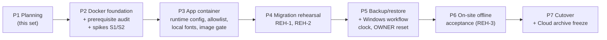

# Implementation Roadmap — Offline Docker Edition

| Field | Value |
|---|---|
| Status | Phase 1 approved. **Phase 2 spike executed 2026-10-19** — Windows-side gates (S1, notebook prerequisites, upstream image digests) still open; see [`PHASE-2-SPIKE-RESULTS.md`](PHASE-2-SPIKE-RESULTS.md). Phase 3 only after approval. |
| Date | 2026-10-19 |
| Baseline | `v1.2.1` (`main` @ `53ed3f7`) |
| Documents | [ADR](OFFLINE-ARCHITECTURE-ADR.md) · [Deployment](DOCKER-DEPLOYMENT-PLAN.md) · [Data migration](DATA-MIGRATION-PLAN.md) · [Acceptance](OFFLINE-ACCEPTANCE-CRITERIA.md) · [Phase 0 audit](PHASE-0-AUDIT.md) |

---

## 1. Ground rules for every phase

- Each phase ends at a **gate** with a written report and **stops for approval** before the next phase.
- Work happens on branch `feat/offline-docker-v1` from `v1.2.1` (`53ed3f7`), local only until the Vercel Preview question (R18) is settled. No commit to `main`, no push, no tag without explicit approval. The `v1.2.1` tag is never moved.
- Supabase Cloud: untouched until Phase 7, except the separately approved **read-only** extraction in Phase 4. Vercel Production: untouched until Phase 7.
- `.env.local` is never read, printed or modified; secrets are never printed or copied.
- Every SQL script is reviewed before it runs anywhere. No new repository migration is planned.
- Existing quality gates stay green on every change: typecheck, lint, tests, production build.
- "Offline ready" is claimed only after the Phase 6 acceptance record is signed.

## 2. Phase overview

| Phase | Estimate (working days) | Touches Cloud | Touches Vercel | Client notebook |
|---|---|---|---|---|
| P2 Docker foundation | 3–4 | No | No | Read-only audit; Docker Desktop installed by the owner if missing |
| P3 App container | 3–4 | No | No | — |
| P4 Migration rehearsal | 2–3 | **Read-only** extraction (approval A-3) | No | — |
| P5 Backup/restore + Windows workflow | 3–4 | No | No | — |
| P6 Offline acceptance | 2–3 (≥ 1 on-site) | No | No | Install under `C:\TomYumBangC`, acceptance volume |
| P7 Cutover | 1 + 14 days hypercare | **Freeze + hardening** (A-6) | **Archive** (A-7) | Production volume, launcher switch |
| **Total** | **14–19** + hypercare | | | |

The Phase 0 estimate (10–15 days) grows by the approved additions: read-only prerequisite audit, off-device USB procedure, clock checks, OWNER reset, a disaster-recovery restore test and a rehearsal on the client notebook.

## 2a. Phase 2 status (evidence: PHASE-2-SPIKE-RESULTS.md)

| Item | Result |
|---|---|
| Git isolation | PASS |
| Prerequisite checker | Implemented, self-test 46/46 PASS; **client notebook run NOT TESTED** |
| Pinned versions | Exist upstream (tags + release binaries verified); **digests NOT TESTED** (Docker Hub blocked in the sandbox) |
| Supabase compatibility | PASS with version-exact substitute builds (D01–D15, C01–C16, unchanged UI end-to-end); schema identical to the Production schema dump; **upstream images NOT TESTED** |
| S1 Ollama via `host.docker.internal` | **NOT TESTED — hard gate open** (Ollama Host guard accepts `host.docker.internal`; Linux-engine negative control shows dependence on Docker Desktop forwarding) |
| Resources | Stack ≈ 230 MiB peak measured; Ollama/Windows NOT TESTED |
| Persistence | PASS on Linux Docker Engine (stop/down/down -v/SIGKILL); Docker Desktop NOT TESTED |
| Offline inventory | Complete; sizes/digests produced by the export script |

**To close Phase 2:** run `Test-TomYum-OfflinePrerequisites`, `Export-/Import-TomYum-OfflineImages` and `Invoke-TomYum-Phase2Spike` on the client notebook (and a preparation machine), then review S1 (approval A-9).

## 3. Phases

### Phase 2 — Docker foundation, prerequisite audit and spikes

**Goal:** prove the minimal Supabase subset runs the existing migrations unchanged, and that the client notebook can host it.

| # | Task | Output |
|---|---|---|
| 2.1 | Create branch `offline/docker-edition` | Branch |
| 2.2 | `Test-TomYum-OfflinePrerequisites.ps1` (+ `.cmd`) per deployment plan §2, with Pester tests using mocked CIM/commands | Script, tests |
| 2.3 | Run it on the client notebook; owner remediates any FAIL manually (BIOS virtualization, WSL, Docker Desktop install with admin rights) — guidance only, no automation | Prerequisite report (before/after) |
| 2.4 | Verify and pull pinned images; record digests; `docker save` to release staging | Digest list |
| 2.5 | `deploy/offline/compose.yaml` with `db`, `auth`, `migrate`, `rest`, `gateway`; `90-tybc-roles.sh`; nginx template; offline secrets generator; migrate runner | Compose foundation |
| 2.6 | Fresh install applies the 10 migrations; schema parity against `schema.sql` of the existing production backup (no Cloud access) | Empty RC-10 diff |
| 2.7 | **Spike S1** (client notebook): a container reaches loopback-bound native Ollama via `host.docker.internal:11434`; Ollama Host-header guard accepts it | S1 report |
| 2.8 | **Spike S2**: `supabase-js` (server client, admin client, `getClaims`) against the gateway with a synthetic user on a throwaway volume; RLS select as `authenticated`; service-role write | S2 report |

**Gate G2:** RC-10 empty; S1 PASS (or owner decision on the alternatives in ADR §5 — never `0.0.0.0`); S2 PASS; no published ports; repository gates unchanged.
**Phase 2 outcome (2026-10-19):** done — 2.1 branch, 2.2 checker (self-test), 2.5 compose foundation, 2.6 fresh install + schema parity with the backup's `schema.sql` (identical, incl. grants), 2.8 S2 (sandbox, version-exact substitute images); **NOT TESTED** — 2.3 notebook run, 2.4 upstream digests, upstream-image repeat of 2.5/2.6/2.8, 2.7 S1 — pending a Windows run (PHASE-2-SPIKE-RESULTS.md §11).
**Rollback:** delete branch work and throwaway volumes; nothing outside the branch changed.

### Phase 3 — Application container

**Goal:** the unchanged application runs in a container against the local stack, with no build-time environment coupling and no Internet dependency.

**Proposed split after Phase 2:** **3a** = tasks 3.1–3.6 (S1-independent, branch-local, Vercel-neutral) plus applying Phase 2 findings F1–F13 to the deployment plan, data migration plan and acceptance criteria; **3b** = Local AI wiring/validation through `host.docker.internal` (part of 3.7), only after S1 PASS. Phase 2 evidence for 3.3/3.4: the production build must use **Turbopack** (a webpack build drops Tailwind, F8); a Turbopack build with `next/font/local` succeeded with no egress (F9); the image gate must look for the Cloud project ref, `restaurant-stock-rho` and font hosts rather than generic `supabase.co`/`api.openai.com` strings that live inside libraries (F7).

| # | Task | Output |
|---|---|---|
| 3.1 | Runtime Supabase configuration: `TYBC_SUPABASE_URL` / `TYBC_SUPABASE_PUBLISHABLE_KEY` with fallback to `NEXT_PUBLIC_*` in `server.ts`, `proxy.ts`, `admin.ts`; fail-fast error; unit tests | Code + tests |
| 3.2 | Ollama allowlist (ADR §5) incl. port rule if O-2 approved; full accept/reject matrix tests | Code + tests |
| 3.3 | Conditional `output: "standalone"` (`TYBC_BUILD_TARGET=docker`); multi-stage Dockerfile; `.dockerignore`; image gate script | Image `tybc-app` |
| 3.4 | Local fonts (`next/font/local`, same CSS variables, OFL licences); screenshot parity at 400/768/1024/1440 | Fonts + screenshots |
| 3.5 | Confirm Cloud AI degrades cleanly with `OPENAI_*` unset; change only if it does not | Note or small fix |
| 3.6 | `Check-TomYum-Offline` (no Cloud checks) | Script |
| 3.7 | Synthetic end-to-end on `127.0.0.1:3100`: sign-in, dashboard, every stock and purchasing flow, reports, Local AI | E2E report |

**Gate G3:** typecheck, lint, full test suite, `next build` without font mocks, Docker build, image gate (no Cloud ref/fonts hosts/secrets), synthetic E2E pass; diff review confirms no business-logic, RLS, function, migration or ledger change; Vercel behaviour unchanged by construction (unset `TYBC_*`).
**Rollback:** revert branch commits.

### Phase 4 — Data migration rehearsal

**Goal:** a repeatable, verified Cloud → local load.

| # | Task | Output |
|---|---|---|
| 4.1 | Loader (data plan §4–§5) and reconciliation pack RC-01…RC-14 with report generator | Tooling |
| 4.2 | **REH-1** from the existing backup `production-20261015-223431` (no Cloud access) | Reconcile report |
| 4.3 | **Approval A-3**, then read-only extraction from Cloud (`default_transaction_read_only=on`) | Artefacts + `SHA256SUMS` |
| 4.4 | **REH-2** from those artefacts; time every step | Reconcile report, timings |
| 4.5 | Draft `deploy/cutover/cloud-freeze.sql` and `cloud-unfreeze.sql` for review — **not executed** | Reviewed drafts |

**Gate G4:** RC-01…RC-14 PASS for REH-1 and REH-2; OWNER signs in with the existing password on the rehearsal stack; no write to Cloud (read-only session settings in the logs).
**Rollback:** delete rehearsal volumes and copied data (keep reports).

### Phase 5 — Backup/restore and Windows workflow

**Goal:** the notebook can be operated, backed up, restored and recovered by the owner without a developer.

| # | Task | Output |
|---|---|---|
| 5.1 | `backup` service: schedule + catch-up, manifest, verification, GFS retention | Service |
| 5.2 | `Copy-Backup-To-USB` with label detection and on-USB verification; encryption per O-4 | Script |
| 5.3 | `Restore-TomYum` blue/green using the Phase 4 loader | Script |
| 5.4 | `Install-`, `Start-`, `Stop-`, `Backup-Now` scripts; release bundle builder (`RELEASE.json`, `SHA256SUMS`) | Scripts, bundle |
| 5.5 | Clock checks T1–T4 with test hook | Script |
| 5.6 | `Reset-Owner-Password` (stdin-only secret path, session revocation, audit log) | Script |
| 5.7 | Operator runbook (language per O-11): daily start/stop, weekly USB, restore, OWNER reset, "never" list (Docker Desktop reset/purge, `down -v`) | Runbook |

**Gate G5:** on a Windows + Docker Desktop test machine with rehearsal data: AC-BKP-01…05, AC-RST-01…02, AC-CLK-01…03, AC-RESET-01…02 pass.
**Rollback:** revert branch commits; remove test volumes.

### Phase 6 — On-site offline acceptance

**Goal:** prove the full catalogue on the client notebook with no Internet.

| # | Task | Output |
|---|---|---|
| 6.1 | Install the release bundle on the notebook (`docker load`, `C:\TomYumBangC`, secrets, external volume) | Installed release |
| 6.2 | **REH-3** into `tybc_db_data_acceptance`; full cutover sequence timed | Reconcile report, timings |
| 6.3 | Run [`OFFLINE-ACCEPTANCE-CRITERIA.md`](OFFLINE-ACCEPTANCE-CRITERIA.md) sections A–M with Wi-Fi off and no route | Evidence bundle |
| 6.4 | Operator training with the owner | Training checklist |
| 6.5 | Sign-off; wipe the acceptance volume | Signed record |

**Gate G6:** all MUST pass; SHOULD waivers signed; cutover date proposed.
**Rollback:** remove the acceptance volume; the notebook keeps working with the cloud launcher until cutover.

### Phase 7 — Cutover

**Goal:** local becomes the sole write authority; Cloud becomes a frozen archive.

Runbook: data plan §7.2. Approvals required on the day: **A-5** (date, freeze window), **A-6** (execute the reviewed Cloud freeze, then L2–L4 hardening), **A-7** (Vercel archive option per O-3), **A-8** (merge/tag per O-7).

**Gate G7:** AC-CUT-01…05 pass; first daily backup and USB copy verified; hypercare plan active.
**Rollback:** data plan §9 — before the first local business write: discard local volume, run `cloud-unfreeze.sql`, continue on Cloud. After it: local is the truth; recovery only from local backups.

## 4. Approvals register

| ID | Approval | Phase | Who |
|---|---|---|---|
| A-1 | Start Phase 2 (this document set) — **approved** | P1 → P2 | Owner |
| A-2 | Owner installs/enables Docker Desktop, WSL2, BIOS virtualization on the notebook if the audit reports FAIL — **approved**, after the read-only check reports the exact deficiency; BIOS never changed automatically | P2 | Owner (admin) |
| A-9 | On-site run of the prerequisite checker and the Phase 2 runner on the client notebook (or linking the notebook to a session) to close S1 and the Windows NOT TESTED items | P2 | Owner |
| A-10 | Vercel Preview handling before any push of `feat/offline-docker-v1` (Ignored Build Step or confirmed Preview environment) | before any push | Owner |
| A-3 | Read-only Cloud extraction for REH-2 | P4 | Owner |
| A-4 | Apply recommended `.wslconfig` and Docker Desktop settings (start at sign-in, auto-update off) | P5/P6 | Owner (operator) |
| A-5 | Cutover date and freeze window | P7 | Owner |
| A-6 | Execute Cloud freeze and archive hardening | P7 | Owner |
| A-7 | Vercel Production archive change | P7 | Owner |
| A-8 | Merge to `main`, push, release tag | P7 | Owner |

## 5. Open decisions

| ID | Question | Recommendation | Needed by |
|---|---|---|---|
| O-1 | Docker Desktop licence: is the business within Docker's free-use limits (small business)? | **Resolved: `DOCKER_DESKTOP_LICENSE_ELIGIBILITY=CONFIRMED`** (recorded in `deploy/offline/decisions.env`, no figures) | — |
| O-2 | Pin Ollama port to `11434` in the allowlist? | **Resolved: approved** — targets exactly `http://127.0.0.1:11434`, `http://[::1]:11434`, `http://host.docker.internal:11434` | — |
| O-3 | Vercel after cutover: protection only / archive banner build / remove production domain | Protection only (no code change); banner optional | Before P7 |
| O-4 | USB encryption: BitLocker To Go (needs a supporting Windows edition) or 7-Zip AES-256 | Decide from the prerequisite report (P01 edition) | Before P5.2 |
| O-5 | Daily backup time and weekly USB owner | 23:30; owner every Monday | Before P5.1 |
| O-6 | Clock thresholds and who may override | Warn 5 s, block 60 s; override by OWNER only, logged | Before P5.5 |
| O-7 | Branch/release: merge to `main` before or after cutover (`main` may auto-deploy to Vercel Production) | Keep on `feat/offline-docker-v1` until cutover; tag `v1.3.0` at cutover | Before P7 |
| O-13 | Exact nginx gateway image tag (official vs unprivileged alpine) | Choose an exact version tag on the preparation machine; the export script refuses floating tags | Before P2 close |
| O-14 | S1 fallback if Docker Desktop does not reach loopback Ollama (options A–D in PHASE-2-SPIKE-RESULTS.md §7) | Decide only if S1 fails | After S1 |
| O-8 | Cutover date and freeze window | Low-activity day, ~3 h window | After G6 |
| O-9 | Off-site custodian of the second USB drive | Owner | Before P6 |
| O-10 | Exclude `auth.audit_log_entries` from the live migration (kept in archive dump) | Exclude | Before P4.1 |
| O-11 | Runbook language | Thai with English command names | Before P5.7 |
| O-12 | Extra notebook hardening: system-drive BitLocker, Windows password/screen-lock policy | Recommended | Before P6 |

## 6. Top risks to watch (full register: ADR §8)

| Risk | Earliest signal | Phase |
|---|---|---|
| R1 / R19 Ollama unreachable from container | Spike S1 on the notebook (still open) | P2 |
| R6 Pinned image/version unavailable or Cloud upgraded | Task 2.4 / data plan step 1 | P2, P7 |
| R5 Reconciliation mismatch | REH-1/REH-2 | P4 |
| R2/R3 Data loss on the notebook | AC-RST-03, operator training | P5–P6 |
| R8 Memory pressure | AC-PERF-03 | P6 |
| R4 Second live system after cutover | AC-CUT-01, AC-CUT-03 | P7 |
| R16–R22 (new in Phase 2): offline digest refs, silent bootstrap failure, Vercel Preview on push, sandbox fidelity, webpack/Tailwind, Docker Desktop first-run offline | PHASE-2-SPIKE-RESULTS.md §12 | P2–P6 |
