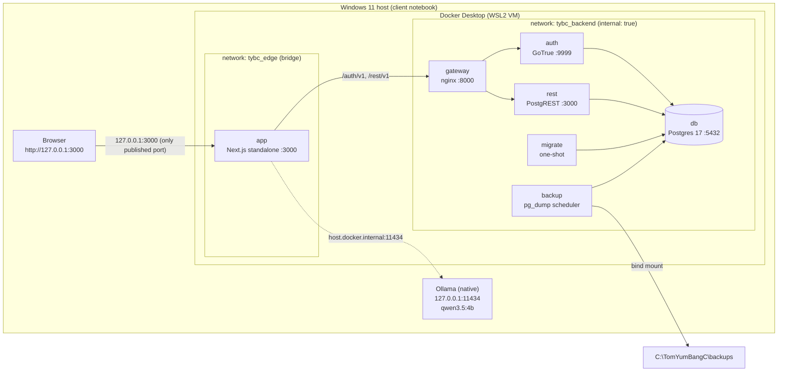

# ADR-001 — Offline Docker Edition Architecture

| Field | Value |
|---|---|
| Status | **Superseded** — replaced by ADR-002 (Ollama in Docker Compose) on 2026-10-20 |
| Date | 2026-10-19 |
| Baseline | `v1.2.1` (`main` @ `53ed3f7`) |
| Inputs | [`PHASE-0-AUDIT.md`](PHASE-0-AUDIT.md) (blockers B1–B12), owner decisions at Phase 1 kickoff |
| Related | [`DOCKER-DEPLOYMENT-PLAN.md`](DOCKER-DEPLOYMENT-PLAN.md) · [`DATA-MIGRATION-PLAN.md`](DATA-MIGRATION-PLAN.md) · [`OFFLINE-ACCEPTANCE-CRITERIA.md`](OFFLINE-ACCEPTANCE-CRITERIA.md) · [`IMPLEMENTATION-ROADMAP.md`](IMPLEMENTATION-ROADMAP.md) |

> **Superseded architecture notice (2026-10-20):** This ADR records the original native-Windows-Ollama design and remains unchanged as historical rationale. The validated final runtime now runs Ollama as an internal Docker Compose service. See ADR-002 for the current architecture.

> **Guardrails for every phase until cutover is approved.** Do not modify Supabase Cloud, change Vercel Production, modify `.env.local`, modify the `v1.2.1` tag, reset any linked database, run `supabase db reset --linked`, or copy/print secrets. Cloud access before cutover is limited to read-only extraction (see the data migration plan).

---

## 1. Context

TOM YUM BANG C Restaurant Stock runs today as:

- **Vercel Production** (`restaurant-stock-rho.vercel.app`) + **Supabase Cloud** (Postgres 17.11.0.003, GoTrue v2.197.0, PostgREST v14.18).
- A **Windows launcher** on the client notebook that runs `next start` on `127.0.0.1:3000` against Supabase Cloud, with **native Windows Ollama** (`qwen3.5:4b`) for the Local AI summary.

The restaurant needs an edition that runs **entirely on the client notebook with no usable Internet route**. Phase 0 found that the application is tightly and deliberately coupled to Supabase semantics: server-side `supabase-js` (cookie session + RLS for reads, service role after `user_has_permission` for writes), 17 RLS policies built on `auth.uid()`, 14 `SECURITY DEFINER` functions, 12 foreign keys into `auth.users`, an append-only stock ledger enforced by triggers, and 10 migrations (5,819 lines) recorded by the Supabase CLI.

Client notebook: Windows 11, Ryzen 7 6800H, 16 GB RAM, AMD Radeon integrated GPU (no Docker GPU passthrough).

## 2. Locked decisions (approved at Phase 1 kickoff)

| ID | Decision |
|---|---|
| **D1** | **Local is the sole write authority after cutover.** Only the local system accepts Stock In, Stock Out, Adjustments, Waste, Stock Counts, Purchase Orders, Receiving, or any mutation that affects the stock ledger. No dual-write, no conflict resolution, no bidirectional sync. |
| **D2** | **Cloud becomes a frozen read-only archive at cutover.** Vercel and Supabase Cloud stay untouched during development and rehearsal. At cutover they become a historical archive and must not remain a second live operational system. Write prevention is designed in [`DATA-MIGRATION-PLAN.md` §8](DATA-MIGRATION-PLAN.md#8-cloud-read-only-cutover-strategy); it is not implemented in Phase 1. |
| **D3** | **Client notebook prerequisite audit is read-only.** It reports Windows version/architecture, RAM, disk, BIOS virtualization, WSL2, Docker Desktop/Engine/Compose, ports, Ollama install/API/model. It never modifies BIOS, WSL, Docker, Windows features or networking. Deficiencies are reported first. |
| **D4** | **Ollama stays native on Windows.** The Next.js container reaches it at `http://host.docker.internal:11434`. Host validation becomes a strict allowlist: `127.0.0.1`, `[::1]`, `host.docker.internal`. No arbitrary IPs, no remote Ollama. Ollama is never intentionally exposed to the Internet, the restaurant LAN or external hosts. |
| **D5** | **Target architecture:** Next.js app container; local PostgreSQL, GoTrue, PostgREST; a minimal internal gateway required by `supabase-js`; persistent Docker volumes; native Windows Ollama; automated local backups and an off-device backup procedure. Compatibility is preserved for the Supabase client, `auth.uid()`, RLS policies, `auth.users` relationships, PostgreSQL functions, the immutable stock ledger and the existing migration history. |

## 3. Decision

Adopt **Option A — a minimal, version-pinned, self-hosted Supabase subset** on Docker Desktop (WSL2 backend):

| Component | Image (pinned; digest recorded in Phase 2) | Why it exists |
|---|---|---|
| `db` | `supabase/postgres:17.11.0.003` | Same engine build as Cloud: Supabase roles (`anon`, `authenticated`, `service_role`, `authenticator`, `supabase_auth_admin`), `auth` schema helpers, `pgcrypto`, `gen_random_uuid`. |
| `auth` | `supabase/gotrue:v2.197.0` | Same auth schema version as Cloud, so `auth.users`/`auth.identities` rows and bcrypt hashes import verbatim and the OWNER keeps the same password. |
| `rest` | `postgrest/postgrest:v14.18` | Same query semantics, JWT role switching and `max_rows` behaviour that `supabase-js` relies on. |
| `gateway` | nginx (alpine/unprivileged, pinned) | `supabase-js` addresses one base URL with `/auth/v1` and `/rest/v1` prefixes; the gateway routes them and enforces an `apikey` allowlist. Not published. |
| `migrate` | `tybc-ops` (built `FROM` the pinned `supabase/postgres` image) | Applies `supabase/migrations/*.sql` in order and records them in `supabase_migrations.schema_migrations` (CLI-compatible). |
| `backup` | `tybc-ops` | Scheduled logical backups, retention, manifests (same base image ⇒ `pg_dump` 17 matches the server). |
| `app` | `tybc-app` (Next.js 16 `output: "standalone"`, Node LTS pinned) | The existing application with runtime (not build-time) Supabase configuration. |
| Ollama | native Windows install (unchanged) | Local AI; CPU inference on the AMD iGPU notebook. |

Not included: Studio, Kong, Realtime, Storage, imgproxy, postgres-meta, Edge Functions, Analytics/Logflare, Vector, Supavisor, Mailer/SMTP. Phase 0 confirmed none are used (no `storage`, `realtime`, `pg_net`, `cron`, `vault` usage).

## 4. Alternatives considered

| # | Alternative | Outcome | Reason |
|---|---|---|---|
| A1 | **Option B — plain PostgreSQL + custom auth** | Rejected | Rewrites 83 queries, 12 RPC call sites, 13 auth calls, RLS and `auth.users` FKs; new password system; ~20–30 days with high regression risk to ledger and purchasing (Phase 0 §15). |
| A2 | **Official Supabase self-hosting compose (full stack)** | Rejected | ~12 containers, several GB RAM on a 16 GB notebook shared with Ollama (B12), more images to pin and patch, larger attack surface, Studio exposes a DB admin UI. |
| A3 | **`supabase start` (CLI local stack) as runtime** | Rejected | Development tool, not a supported production runtime; binds 5432x ports; version coupled to the CLI; `db reset` foot-gun next to production data. |
| A4 | **Kong as gateway** | Fallback only | Kong is Supabase's reference gateway, but costs ~150–250 MB and a declarative config; nginx covers the two routes and the key allowlist in a few MB. Switch to Kong only if Phase 2 finds a `supabase-js` behaviour nginx cannot reproduce. |
| A5 | **Ollama in a container** | Rejected | No AMD GPU passthrough in Docker Desktop (B7); duplicates the ~3 GB model and RAM; the native install already works and is measured. |
| A6 | **Database on an NTFS bind mount** (`C:\...` → `/var/lib/postgresql/data`) | Rejected | Postgres on drvfs/9P bind mounts has permission, fsync and performance problems. A named volume on the Docker VM's ext4 disk is used; durability comes from backups that *are* on NTFS and USB. |
| A7 | **Docker Engine inside a WSL distro (no Docker Desktop)** | Fallback only | No licence question, but `host.docker.internal` → Windows loopback does not work under default WSL NAT networking, which would push Ollama off loopback (conflicts with D4). Revisit only if Docker Desktop is not acceptable (open decision O-1). |
| A8 | **Asymmetric JWT signing keys** | Deferred | HS256 with a local secret is the smallest moving part; all JWT verification happens inside the Docker network. Consequence: `auth.getClaims()` falls back to a local `getUser` round-trip (milliseconds). |
| A9 | **Sync / dual-write / CRDT** | Rejected | Contradicts D1; the ledger is append-only and has no merge semantics. |

## 5. Ollama host allowlist (D4 specification)

Today `readLocalAiConfig` (`src/lib/ai/providers/ollama.ts`) accepts only `127.0.0.1` and `[::1]` (`LOOPBACK_HOSTNAMES`, reason `NON_LOOPBACK_HOST`). Phase 3 replaces this with:

| Rule | Value |
|---|---|
| Protocol | `http:` only |
| Hostname (exact, after WHATWG URL parsing) | `127.0.0.1`, `[::1]`, `host.docker.internal` — nothing else (no `localhost`, no other `*.internal`, no IP literals, no LAN names) |
| Port | **Proposed:** exactly `11434` (open decision O-2). `host.docker.internal` reaches *every* host-loopback service, so pinning the port limits SSRF reach to Ollama only. |
| Credentials / path / query / fragment | Rejected (path must be empty or `/`) |
| Existing guards | Unchanged: disabled when `VERCEL` is set; requires `AI_LOCAL_ENABLED === "true"`; model, timeout and keep-alive validation unchanged |
| Resolution | String allowlist only; no DNS lookups in validation. Inside the container, `host.docker.internal` is provided by Docker (`extra_hosts: host.docker.internal:host-gateway`). |

| Example `OLLAMA_BASE_URL` | Result |
|---|---|
| `http://127.0.0.1:11434` | accept |
| `http://[::1]:11434` | accept |
| `http://host.docker.internal:11434` | accept |
| `http://localhost:11434` | reject (unchanged behaviour) |
| `http://192.168.1.20:11434`, `http://10.0.0.5:11434` | reject |
| `http://gateway.docker.internal:11434`, `http://ollama.internal:11434` | reject |
| `https://host.docker.internal:11434` | reject (protocol) |
| `http://host.docker.internal:5432` | reject (port, if O-2 approved) |
| `http://user:pw@127.0.0.1:11434`, `http://127.0.0.1:11434/api` | reject |

Network posture:

- Ollama stays bound to `127.0.0.1:11434` (`OLLAMA_HOST` unset or loopback). The prerequisite check **fails** if 11434 listens on `0.0.0.0`/`::` and reports any inbound firewall rule for `ollama.exe`.
- Docker Desktop proxies `host.docker.internal` connections to the Windows host. Whether that reaches a **loopback-bound** native Ollama on the client notebook is verified in **spike S1** (Phase 2). Ollama's DNS-rebinding Host-header guard is expected to accept `host.docker.internal` (it allows `*.internal` names) — also verified in S1.
- **If S1 fails, stop and return to the owner.** Do not bind Ollama to `0.0.0.0` or a LAN address. Candidate options (each needs approval): Docker Desktop mirrored/host networking settings, or a narrowly scoped bind plus firewall rule.
- On the bare Windows host, Docker Desktop may add `host.docker.internal` → *LAN IP* to the Windows `hosts` file. The existing native launcher keeps `127.0.0.1`, so this alias is only used inside containers.

## 6. Compatibility guarantees

| Must be preserved | How | Verified by |
|---|---|---|
| `supabase-js` server usage (user client, admin client, `proxy.ts` `getClaims`) | Same API paths through the gateway; legacy-format anon/service JWTs signed with the local secret; runtime URL/key indirection | AC-AUTH-*, AC-OPS-* |
| `auth.uid()` and 17 RLS policies | Same Postgres image and roles; PostgREST switches to `authenticated` from the GoTrue JWT | AC-SEC-06, migration RC-10 |
| 12 FKs into `auth.users`, `handle_new_user` | `auth.users`/`auth.identities` imported verbatim with the same UUIDs (triggers suppressed during load) | migration RC-05, RC-09 |
| 14 `SECURITY DEFINER` functions, grants | Applied by the unchanged migrations; schema-only parity diff against Cloud must be empty | migration RC-10 |
| Immutable ledger (`stock_movements_prevent_update/delete`, receipt/waste immutability, idempotency index) | Unchanged migrations; triggers re-enabled after load and checked | AC-LEDGER-*, RC-11 |
| Migration history | Same 10 files, applied in order, versions recorded in `supabase_migrations.schema_migrations` | migration RC-01 |
| Vercel Production behaviour | Every app change is behaviour-neutral on Vercel (fallback to today's env vars) and is not merged to `main` without approval | Roadmap gates |

## 7. Consequences

**Positive**

- Application logic, RLS, functions, ledger and migrations are reused unchanged; no DB migration is required for the offline edition.
- The OWNER logs in offline with the same password (bcrypt hash migrates).
- ~5 long-running containers; estimated ≤ 2.3 GB container memory ceiling (budget in the deployment plan).
- Backups are logical and portable, so a lost notebook or corrupted Docker disk is recoverable onto a fresh install.

**Negative / costs**

- Six infrastructure components to pin, archive offline (image tarballs) and upgrade deliberately.
- The notebook is the only live copy of the ledger after cutover (B4); backup discipline (daily automatic + weekly USB) becomes an operational duty.
- No password-reset email offline; a manual OWNER reset procedure is required (B8).
- No automatic time synchronisation offline; clock checks are required (B11).
- Docker Desktop is required (licence confirmation O-1; admin rights for the one-time install).

**Application changes required later (Phase 3; none in Phase 1)**

| Area | Files | Vercel effect |
|---|---|---|
| Runtime Supabase URL/key (`TYBC_SUPABASE_URL`, `TYBC_SUPABASE_PUBLISHABLE_KEY`, fallback to `NEXT_PUBLIC_*`) | `src/lib/supabase/server.ts`, `proxy.ts`, `admin.ts` | None (variables unset on Vercel) |
| Ollama allowlist | `src/lib/ai/providers/ollama.ts`, `types.ts`, tests | None (Local AI disabled on Vercel) |
| `output: "standalone"` when `TYBC_BUILD_TARGET=docker` | `next.config.ts` | None (variable unset on Vercel) |
| Local fonts (`next/font/local`, same CSS variables) | `src/app/layout.tsx`, vendored `woff2` + licences | Visual parity expected; verified by screenshots |
| Offline ops tooling (reset, reconcile, backup, checks) | new `deploy/offline/**`, `scripts/windows/*Offline*` | None |

No change to RLS, functions, migrations, ledger, purchasing logic or the Local AI prompt/engine.

## 8. Risk register

| ID | Risk | L | I | Mitigation |
|---|---|---|---|---|
| R1 | Container cannot reach loopback-bound native Ollama via `host.docker.internal` | M | M | Spike S1 in Phase 2 on the real notebook; stop-and-ask if it fails; never bind 0.0.0.0. AI failure does not block stock operations. |
| R2 | Notebook disk/VM corruption or loss ⇒ ledger loss | M | H | Daily automatic backup + catch-up on start; weekly verified USB copy on 2 rotating drives; quarterly restore drill; restore tested on a clean install. |
| R3 | Accidental `docker compose down -v`, Docker Desktop "Reset to factory defaults" or uninstall deletes the DB volume | M | H | Scripts never use `-v`; operator runbook warning; backups; volume name is explicit and external. |
| R4 | Writes continue on Cloud after cutover (second live system) | M | H | Cloud freeze applied **before** the final dump; DB-level triggers + revokes + key removal; Vercel access restricted. |
| R5 | Imported data differs from Cloud | L | H | Reconciliation catalogue (counts, md5 per table, balances, FKs, parity); any mismatch = No-Go. |
| R6 | Version mismatch (GoTrue/Postgres image tags unavailable or differ from Cloud by cutover) | M | M | Pin by digest in Phase 2; archive image tarballs; re-check Cloud versions read-only before the final dump. |
| R7 | Clock drift or backwards jump corrupts ledger chronology/reports | M | M | Start-time clock checks (host vs VM vs DB vs last-seen); block above threshold; monthly manual time check. |
| R8 | 16 GB RAM pressure (Ollama + VM + browser) | M | M | Per-container memory limits; recommended `.wslconfig` cap (operator-applied); AI optional; measured in acceptance. |
| R9 | Docker Desktop licence/updates/sign-in prompts | L | M | Confirm eligibility (O-1); disable auto-update in Desktop settings (operator); no sign-in required for local use. |
| R10 | Secrets leak (env in image, logs, backups) | L | H | No secrets at build; `.dockerignore` excludes `.env*`; image string scan; secrets file outside repo with restricted ACL; scripts never print secrets. |
| R11 | Offline build blocked (Google Fonts, npm) | H→L | M | Local fonts (Phase 3); images pre-built and archived as tarballs; rebuilds are not part of normal operation. |
| R12 | Merging offline work to `main` deploys to Vercel Production | M | M | Work on a branch; behaviour-neutral changes only; merge requires explicit approval (O-7). |
| R13 | Real transactions typed into a rehearsal stack | L | M | Rehearsal uses a separate project/volume and port 3100, run by the developer only, wiped after. |
| R14 | Sleep/hibernate pauses containers mid-operation or skips backups | M | L | Catch-up backup on start; clock check after resume; recommended power plan (operator). |
| R15 | Unknown production behaviour of PostgREST/GoTrue offline (e.g., outbound calls) | L | M | Acceptance is executed with Wi-Fi off and no route; no-egress checks. |

L = likelihood, I = impact (L/M/H).

## 9. Out of scope

Multi-device/LAN access (other tablets or POS reaching the notebook), multi-branch sync, replication or HA, email delivery, OAuth providers, cloud backups, containerised Ollama, GPU acceleration, and any change to business logic.

## 10. Approval

| Role | Name | Decision | Date |
|---|---|---|---|
| Owner | | ☐ Approve ☐ Changes requested | |
| Developer | | Prepared | 2026-10-19 |
